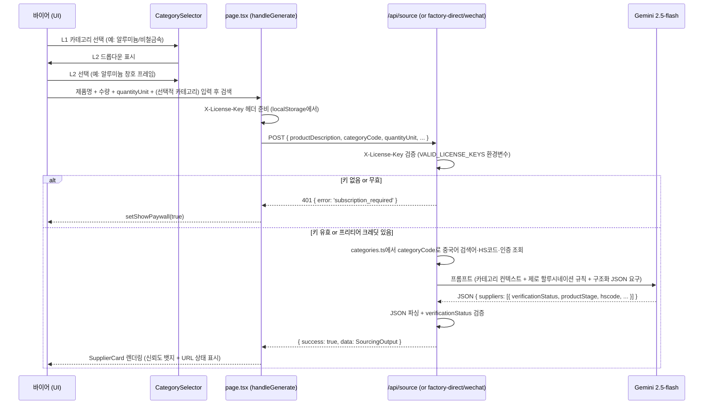

# feat: GloSource AI — 건자재 특화 B2B AI 소싱 플랫폼 (Option A)

## Overview

GloSource AI MVP(AI 검색 데모)를 건설·건축자재 특화 B2B AI 중개 서비스로 업그레이드한다.
변경 핵심: ① 100개 건자재 카테고리 체계 → AI 매칭 정확도 대폭 향상, ② 공급자 신뢰도
계층화(검증 상태 표시) → 할루시네이션 피해 방지, ③ 서버사이드 라이선스 키 구독 →
실수익 파이프라인 완성, ④ 컴포넌트 분리 → 향후 기능 확장 가능한 코드베이스.

3~4주 내 배포 목표. 공급자 자체 등록은 없음(Option B 범위). AI(Gemini)가 유일한
데이터 레이어.

## Problem Frame

현재 GloSource AI의 3대 신뢰 파괴 요소:

1. **할루시네이션 노출** — Gemini가 생성한 공급자명·URL이 실존하지 않을 수 있다.
   바이어가 존재하지 않는 링크를 클릭하면 플랫폼 신뢰가 즉시 파괴된다.
2. **카테고리 없는 자유 텍스트** — 건자재는 철강·알루미늄·콘크리트·배관·전기 등
   수백 개 카테고리를 포함한다. 하나의 텍스트 입력창은 AI에게 컨텍스트를 주지 못해
   부정확한 중국어 검색어, 잘못된 HS코드, 부적절한 인증 기준이 반환된다.
3. **구독 강제 없음** — localStorage의 크레딧 값을 DevTools로 수정하면 무제한 무료
   이용이 가능하다. 수익 모델이 존재하지 않는다.

## Requirements Trace

- R1. 건자재 10개 L1 대분류 × 10개 L2 소분류 = 100개 카테고리 체계 구축
- R2. 카테고리 선택 시 중국어 검색어·HS코드·관련 인증이 AI 프롬프트에 자동 주입
- R3. 모든 공급자에 `verificationStatus: 'grounding_confirmed' | 'ai_estimated'` 표시
- R4. `url`이 빈 문자열이거나 `ai_estimated`인 공급자는 링크 비활성화 + 경고 뱃지
- R5. `quantityUnit` 필드 추가 — RFQ 이메일에 단위 혼동 방지 문구 자동 포함
- R6. `POST /api/verify-license` — `VALID_LICENSE_KEYS` 환경변수 기반 키 검증
- R7. 3개 소싱 API 라우트 모두 `X-License-Key` 헤더 서버사이드 검증; 없으면 401
- R8. 401 `{ error: 'subscription_required' }` → 클라이언트 결제 모달 자동 트리거
- R9. WeChat 검색 전 Gemini로 한국어 키워드를 중국어로 사전 번역
- R10. WeChat 결과에서 `relevanceScore < 50` 자동 필터링
- R11. `page.tsx`에서 5개 컴포넌트 분리 (SupplierCard, WeChatCard, RFQComposer, PaywallModal, CategorySelector)
- R12. 공급자 카드에 `productStage`, `leadTimeDays`, `hscode` 표시

## Scope Boundaries

- 공급자 자체 등록·로그인 없음 (Option B)
- Toss Payments 연동 없음 — 라이선스 키는 이메일 수동 발급 (Phase 2 과제)
- 공급자 DB 없음 — Gemini 그라운딩이 유일한 데이터 레이어
- 구독 취소·환불 흐름 없음 (Phase 2)
- `groundingMetadata` 청크 URL과 공급자 URL 매칭 없음 — `verificationStatus`는 AI 자체 보고 (Phase 2)
- 다국어 UI 없음 (한국어 단일)
- PDF 출력 개선 없음 (`window.print()` 유지)

## Context & Research

### 현재 코드베이스 핵심 파일

- `app/api/source/types.ts` — `Supplier`, `SourcingRequest`, `WeChatPost` 타입의 단일 정의처
- `app/api/source/route.ts` — 메인 AI 소싱; `buildPrompt()` 함수가 프롬프트 엔트리포인트
- `app/api/source/factory-direct/route.ts` — 1688 전용; `build1688Prompt()` 함수
- `app/api/source/wechat/route.ts` — Sogou 스크래핑; `scrapeSogouWeChat()` 한국어 키워드 문제
- `app/page.tsx` — 942줄 단일 파일; 모든 UI·상태·로직 인라인. `glosource_credits_v1`은 line ~263 크레딧 게이트
- `app/globals.css` — Tailwind 베이스만 임포트. 색상 토큰 없음
- Gemini 폴백 체인: `gemini-2.5-flash` + grounding → `gemini-2.5-flash` 단독 → `gemini-1.5-flash`
- JSON 추출 패턴: 마크다운 펜스 제거 → `[n]` 인용번호 제거 → `<thinking>` 태그 제거 → `{…}` regex 추출

### 확인된 기술적 사실

- Next.js 16.2.4 App Router, `@google/generative-ai` v0.24.1, Tailwind CSS v4, cheerio v1.2.0
- DB 없음. 인증 없음. 컴포넌트 없음.
- `GEMINI_API_KEY`만 사용 중. Vercel 대시보드에서 설정.
- `@anthropic-ai/sdk`, `jspdf`, `html2canvas` — package.json에 있으나 코드에서 미사용
- WeChat 라우트 line 39: 한국어 키워드가 그대로 Sogou URL에 인코딩 → 한글 깨짐
- 크레딧 게이트 우회: `localStorage.setItem('glosource_credits_v1', '99')` 2초면 완료

### 시뮬레이션 보고서 기록 이슈 (docs/reports/2026-05-01-simulation-aluminum-6063-t5.md)

이번 플랜이 공식적으로 해결해야 할 4개 이슈:
1. WeChat 검색 키워드 인코딩 오류 (Korean+Chinese 혼합 → Sogou URL 깨짐)
2. 1688 vs AI 종합 가격 괴리 (원자재 vs 완성품 구분 없음)
3. WeChat 관련도 낮은 결과 포함 (`relevanceScore < 50` 필터 없음)
4. WeChat 결과 1건뿐 (한글 키워드로 검색했기 때문)

## Key Technical Decisions

- **카테고리 체계는 정적 JSON**: `app/lib/categories.ts` 단일 파일. UI 드롭다운과 AI 프롬프트 주입 둘 다 이 파일에서 구동. 외부 CMS 없음 — 수정 시 코드 배포.
- **카테고리 선택은 선택사항**: 선택 안 해도 기존 자유텍스트 플로우 그대로 동작. 카테고리 선택 시 AI 프롬프트에 중국어 검색어·HS코드·인증이 추가 주입됨.
- **`verificationStatus`는 AI 자체 보고**: Gemini에게 "URL을 그라운딩으로 실제 확인했으면 `grounding_confirmed`, 추정이면 `ai_estimated`로 표시하라"고 지시. groundingMetadata 청크 파싱보다 구현이 단순. 단, AI가 자신을 overconfident하게 보고할 수 있음 — UI에 명시적 면책 문구 추가.
- **라이선스 키 인증 방식**: 환경변수 `VALID_LICENSE_KEYS=key1,key2,key3` (쉼표 구분). 키 회전은 Vercel 대시보드 env var 수정 + 재배포. DB 없이 구현 가능한 MVP 수준. 만료 없음(수동 제거로 비활성화). **구독 티어 정의**: `starter` (키 1~2개, 개인 바이어), `pro` (키 3~5개, 팀 or 중소기업), `team` (키 5개 이상, 조직). 키 접두어로 티어 구분: `STARTER_xxxx`, `PRO_xxxx`, `TEAM_xxxx`. `/api/verify-license` 응답의 `plan` 필드는 접두어에서 파싱 (`key.startsWith('TEAM_') → 'team'` 등).
- **401 → 결제 모달**: API 라우트가 `{ error: 'subscription_required' }` 를 반환하면 클라이언트 `handleGenerate`의 에러 핸들러가 이 문자열을 감지해 `setShowPaywall(true)` 호출. 크레딧 소진 경우와 동일 모달 사용.
- **WeChat 번역 실패 폴백**: Gemini 번역 호출 실패 시 원래 한국어 키워드로 그대로 Sogou 진행. 번역 성공 시 번역된 키워드를 클라이언트에도 반환해 UI 칩으로 표시.
- **RFQ 단위 혼동 방지**: `quantityUnit: '개' | 'kg' | 'ton' | 'm' | 'm2' | 'set'` 필드 추가. RFQ 이메일 템플릿에 "(please also quote per kg/ton if priced by weight)" 문구 자동 포함.

## Open Questions

### Resolved During Planning

- **401 에러 형식**: `{ error: 'subscription_required' }` → 클라이언트가 감지해 paywall 모달 트리거. 기존 에러 표시 UI와 분리.
- **카테고리 선택 필수 여부**: 선택사항. 카테고리 없이도 기존 플로우 동작.
- **카테고리 불일치 처리**: 소프트 경고("선택하신 카테고리와 제품명이 다를 수 있습니다"), 제출 차단 없음. AI 프롬프트는 제품명 설명을 우선 권위로 지시.
- **WeChat 번역 UI 가시성**: 번역된 키워드를 비편집 정보 칩으로 표시 ("중국어 검색: 铝合金型材 6063-T5").
- **Team 플랜 시트별 강제**: MVP에서 불가 — 5개 개별 키 발급으로 대체. 문서화된 한계로 수용.

### Deferred to Implementation

- `verificationStatus: 'grounding_confirmed'` 기준이 얼마나 정확한지 — 실제 배포 후 샘플 응답으로 calibration 필요.
- 라이선스 키 포맷 (UUID vs 알파뉴메릭 vs crypto hash) — 구현 시 결정.
- WeChat 번역 프롬프트 최적화 — 실제 번역 품질은 배포 후 측정.
- `quantityUnit` 드롭다운이 카테고리 선택 후 자동 추천되는지 — 구현 시 단순화 가능.

## High-Level Technical Design

> *이 다이어그램은 의도한 접근 방식의 방향성 안내이며 구현 명세가 아닙니다. 구현 에이전트는 참고 컨텍스트로만 사용해야 합니다.*

### 강화된 검색 플로우 (카테고리 선택 포함)



### 구현 단위 의존성 그래프

```
Unit 1 (Category Taxonomy)
    │
    ├──▶ Unit 2 (Category Selector UI)
    │
    └──▶ Unit 3 (Prompt Engineering)
              └──▶ [모든 API 라우트 개선]

Unit 4 (Page Decomposition) ── 독립 실행 가능 (어느 단계에서도 시작 가능)
    현재 page.tsx 코드를 추출하는 순수 리팩토링.
    Units 2,3,5,6의 새 필드는 각 단위가 완료된 후 해당 컴포넌트에 추가됨.

Unit 5 (WeChat Translation)  ── 독립 실행 가능
Unit 6 (License Key Subscription) ── 독립 실행 가능
```

**실행 전략**: Units 1, 4, 5, 6은 병렬로 시작 가능. Unit 2, 3은 Unit 1 완료 후. Unit 4는 언제든 시작 가능 — 기존 코드 추출 후, 나중에 Units 2/3/5/6의 새 props를 점진적으로 추가하는 방식으로 진행.

**Unit 4 독립 실행 이유**: 컴포넌트 추출은 현재 `page.tsx`에 이미 존재하는 코드를 이동하는 것이다. `verificationStatus` (Unit 3), `translatedKeyword` (Unit 5), `reason` prop (Unit 6) 등 새로운 필드는 해당 단위가 완료된 후 각 컴포넌트의 props에 점진적으로 추가한다.

## Implementation Units

---

- [ ] **Unit 1: 건자재 카테고리 택소노미 데이터 레이어**

**Goal:** 100개(10L1 × 10L2) 건자재 카테고리를 정의한 정적 데이터 파일과 확장된 타입 체계를 만든다. 이 파일이 UI 드롭다운과 AI 프롬프트 주입 모두의 단일 소스가 된다.

**Requirements:** R1, R2, R5, R12

**Dependencies:** 없음

**Files:**
- Create: `app/lib/categories.ts`
- Modify: `app/api/source/types.ts`

**Approach:**

`app/lib/categories.ts`는 `Category` 인터페이스 배열을 export 한다:

```
Category {
  code: string            // 예: 'ALU_WIN' (고유 식별자)
  l1Code: string          // 예: 'ALUMINUM'
  l1NameKo: string        // 예: '알루미늄/비철금속'
  l1NameZh: string        // 예: '铝及有色金属'
  l2NameKo: string        // 예: '알루미늄 창호 프레임'
  l2NameZh: string        // 예: '铝合金门窗框料'
  searchTermsZh: string[] // 예: ['铝型材门窗', '6063铝合金型材', '断桥铝门窗']
  hsCodes: string[]       // 예: ['7604.29', '7610.10']
  certifications: string[] // 예: ['GB 5237', 'KS F 3117', 'ISO 6060']
  typicalPriceRange: string // 예: '¥30~55/kg (완성품 기준)'
  quantityUnitSuggestion: QuantityUnit // 예: 'kg'
}
```

**10개 L1 대분류 (각 10개 L2 포함):**

| L1 코드 | 한국어 | 중국어 |
|---------|--------|--------|
| STEEL | 철강/금속 구조재 | 钢铁/金属结构材料 |
| ALUMINUM | 알루미늄/비철금속 | 铝及有色金属 |
| CONCRETE | 콘크리트/시멘트 제품 | 混凝土/水泥制品 |
| STONE | 석재/타일/세라믹 | 石材/瓷砖/陶瓷 |
| WOOD | 목재/합판/보드류 | 木材/胶合板/板材 |
| GLASS | 유리/창호 시스템 | 玻璃/门窗系统 |
| INSULATION | 방수/단열/마감재 | 防水/隔热/装饰材料 |
| MEP | 배관/위생/HVAC | 管道/卫生/暖通 |
| ELECTRICAL | 전기/케이블/조명 | 电气/电缆/照明 |
| MACHINERY | 건설 기계/장비 부품 | 建筑机械/设备零部件 |

`app/api/source/types.ts`에 추가되는 필드:

`SourcingRequest`에: `categoryCode?: string`, `categoryNameZh?: string`, `quantityUnit?: QuantityUnit`

`Supplier`에: `verificationStatus: 'grounding_confirmed' | 'ai_estimated'`, `productStage: 'raw_material' | 'semi_finished' | 'finished_product'`, `leadTimeDays: string`, `hscode: string`, `exportToKoreaExperience: boolean`

새 타입: `QuantityUnit = '개' | 'kg' | 'ton' | 'm' | 'm2' | 'set'`

**Patterns to follow:**
- `app/api/source/types.ts` — 기존 타입 정의 패턴 (union type + 인터페이스)
- `app/api/source/route.ts`의 `COUNTRY_LABELS` — Record lookup 패턴

**Test scenarios:**
- Happy path: `categories.ts`를 import한 코드에서 `code === 'ALU_WIN'`인 카테고리를 조회하면 `searchTermsZh.length >= 3`이고 `hsCodes.length >= 1`임을 검증
- Edge case: 모든 100개 카테고리 항목에 `code`, `l1NameKo`, `l2NameKo`, `searchTermsZh`, `hsCodes` 필드가 빈 문자열/배열 없이 채워져 있음을 검증 (TypeScript strict 컴파일로 커버 가능)
- Edge case: `code` 값이 전체에서 유일한지 검증 (중복 코드 없음)
- Test expectation: types.ts 타입 변경은 TypeScript strict 컴파일 통과로 검증. 런타임 테스트 없음.

**Verification:**
- `app/lib/categories.ts`를 import해서 100개 항목 존재 확인
- TypeScript 컴파일에서 `Supplier`, `SourcingRequest` 타입 변경 에러 없음
- `verificationStatus`, `productStage`, `hscode` 필드가 타입 정의에 존재함

---

- [ ] **Unit 2: CategorySelector UI 컴포넌트 + Page 통합**

**Goal:** L1 → L2 두 단계 드롭다운을 제공하는 `CategorySelector` 컴포넌트를 만들고, `page.tsx`에 검색 입력 위의 선택적 첫 단계로 통합한다.

**Requirements:** R1, R2

**Dependencies:** Unit 1

**Files:**
- Create: `app/components/CategorySelector.tsx`
- Modify: `app/page.tsx`

**Approach:**
- `CategorySelector`는 `value: string | null`, `onChange: (code: string | null) => void` props를 받는다
- L1 버튼 그리드(10개) → 선택 시 L2 드롭다운 표시
- "카테고리 없이 검색" 버튼으로 선택 초기화
- 카테고리 선택 시 아래에 칩 표시: `알루미늄/비철금속 > 알루미늄 창호 프레임`
- 카테고리 불일치 감지 로직 (선택적 경고): `productDescription`에 선택한 L1과 전혀 무관한 키워드가 있으면 소프트 경고 텍스트 표시. 제출은 차단하지 않음.
- `page.tsx` 상태: 기존 `activeSource`, `result`, `wechatResult` 외에 `selectedCategory: string | null` 추가
  - **이름 매핑 명시**: 클라이언트 상태는 `selectedCategory` (UI 내부), API 요청 body에는 `categoryCode`로 전달. `handleGenerate`가 `body.categoryCode = selectedCategory`로 변환. 두 이름이 다른 것은 의도적 — 상태는 UI 의미, body 필드는 서버 계약.
- `quantityUnit`은 `SourcingRequest` 타입에 추가된 필드로 page.tsx에서 별도 select 입력으로 렌더링. 카테고리 선택 시 `quantityUnitSuggestion`으로 자동 pre-fill (구현 시 단순화 가능 — deferred).

색상 시스템: 현재 `page.tsx`의 Navy/Orange 브랜드 토큰 유지. 선택된 L1은 orange 하이라이트. 선택된 L2는 navy 배경 + white 텍스트.

**Patterns to follow:**
- `app/page.tsx`의 탭 컴포넌트 패턴 (active orange underline)

**Test scenarios:**
- Happy path: L1 "알루미늄/비철금속" 클릭 → L2 드롭다운이 10개 아이템 표시
- Happy path: L2 "알루미늄 창호 프레임" 선택 → `onChange` 콜백에 `'ALU_WIN'` 전달
- Edge case: "카테고리 없이 검색" 클릭 → `onChange(null)` 호출, 칩 사라짐
- Edge case: 카테고리 선택 후 다른 L1 클릭 → L2 드롭다운이 새 L1 항목으로 교체
- Integration: CategorySelector에서 선택한 코드가 `page.tsx`의 `selectedCategory` 상태에 반영되어 `handleGenerate` 호출 시 `body.categoryCode`에 포함됨

**Verification:**
- 10개 L1 버튼 렌더링 확인
- L2 드롭다운 정확한 데이터 표시 확인
- 선택된 카테고리 코드가 API 요청 body에 포함됨을 확인

---

- [ ] **Unit 3: AI 프롬프트 엔지니어링 — 카테고리 어웨어 + 제로 할루시네이션 정책**

**Goal:** 3개 API 라우트의 AI 프롬프트에 ① 카테고리별 중국어 검색어·HS코드·인증 주입, ② 할루시네이션 방지 하드 규칙, ③ 확장된 공급자 필드 추출 지시를 추가한다.

**Requirements:** R2, R3, R4, R5, R12

**Dependencies:** Unit 1

**Files:**
- Modify: `app/api/source/route.ts`
- Modify: `app/api/source/factory-direct/route.ts`
- Modify: `app/api/source/wechat/route.ts` (번역 스텝은 Unit 5에서 담당)

**Approach:**

`buildPrompt()` 함수 시그니처를 `buildPrompt(req: SourcingRequest, categoryContext?: Category)` 로 변경.

카테고리 컨텍스트가 있을 때 프롬프트에 주입되는 섹션 (예시, directional):
```
[카테고리 컨텍스트]
대분류: 알루미늄/비철금속 (铝及有色金属)
소분류: 알루미늄 창호 프레임 (铝合金门窗框料)
중국어 검색어: 铝型材门窗, 6063铝合金型材, 断桥铝门窗, 铝合金型材厂家
관련 HS코드: 7604.29, 7610.10
관련 인증: GB 5237, KS F 3117, ISO 6060
일반 가격대: ¥30~55/kg (완성품 기준)
```

**제로 할루시네이션 규칙** (모든 프롬프트에 추가):
```
[중요 규칙]
1. Google 그라운딩 검색으로 실제 확인한 공급자만 반환하라
2. URL을 직접 확인하지 못했다면 url은 빈 문자열("")로, verificationStatus는 "ai_estimated"로 설정하라
3. 1688.com/Alibaba/Made-in-China URL을 추측으로 생성하지 마라 — 존재하지 않는 URL은 신뢰를 파괴한다
4. 확인된 공급자가 3개 미만이더라도 추측으로 수를 채우지 마라 — 빈 배열보다 정확한 2개가 낫다
```

**추가 공급자 필드 추출 지시** (JSON 스키마에 추가):
```json
{
  "verificationStatus": "grounding_confirmed | ai_estimated",
  "productStage": "raw_material | semi_finished | finished_product",
  "leadTimeDays": "예: 15~20일",
  "hscode": "예: 7604.29",
  "exportToKoreaExperience": true
}
```

`build1688Prompt()`에도 동일한 카테고리 컨텍스트 주입 패턴 적용.

**Patterns to follow:**
- `app/api/source/route.ts`의 `buildPrompt()` 함수 — 기존 프롬프트 구조 유지하고 섹션 추가

**Test scenarios:**
- Happy path: `categoryCode: 'ALU_WIN'`이 포함된 요청이 들어오면 프롬프트에 `铝型材门窗` 검색어가 포함됨을 확인 (응답 JSON 비교 불필요 — 프롬프트 문자열 로그로 검증)
- Happy path: 카테고리 없는 요청은 기존 프롬프트와 동일하게 동작
- Error path: Gemini가 JSON 스키마를 준수하지 않고 `verificationStatus` 필드를 누락한 응답을 반환해도 JSON 파싱이 실패하지 않고 필드를 `'ai_estimated'` 기본값으로 설정함 (파싱 후 디폴트 처리). **소프트 폴백 철학**: WeChat 번역 실패와 동일하게 200 응답 유지 + degraded data 반환. 하드 에러(500) 아님.
- Integration: 실제 API 호출 시 반환된 `Supplier` 객체에 `verificationStatus`, `hscode`, `productStage` 필드가 존재함

**Phase 1 알려진 한계**: `verificationStatus: 'grounding_confirmed'`는 Gemini의 자체 보고이며 서버사이드 URL 존재 검증이 아니다. Gemini가 overconfident하게 보고할 수 있음. UI에 "AI 리서치 결과 — 직접 확인 필수" 면책 문구 표시로 완화. Phase 2에서 `groundingMetadata.groundingChunks` URL과 공급자 URL 매칭으로 교체 예정.

**Verification:**
- `categoryCode: 'STEEL_REBAR'`로 API 호출 시 반환된 공급자의 `hscode`가 `7214`대인지 확인 (한번 수동 호출로 검증)
- `verificationStatus` 필드가 모든 공급자에 존재하며 두 값 중 하나임을 확인

---

- [ ] **Unit 4: 컴포넌트 분리 (page.tsx 942줄 → 오케스트레이터)**

**Goal:** 942줄 `page.tsx`에서 5개 독립 컴포넌트를 추출해 관심사를 분리한다. `page.tsx`는 상태 관리와 API 호출만 담당하는 오케스트레이터로 축소된다.

**Requirements:** R11

**Dependencies:** Units 2, 3, 5, 6 (완료 후 통합하거나, 독립적으로 먼저 진행 가능)

**Execution note:** 이 단위는 동작 변경 없이 순수 리팩토링이다. characterization-first로 진행 — 분리 전 현재 렌더링 결과를 기준으로 삼아 분리 후 동일하게 렌더링됨을 확인.

**Files:**
- Create: `app/components/sourcing/SupplierCard.tsx`
- Create: `app/components/sourcing/WeChatCard.tsx`
- Create: `app/components/sourcing/RFQComposer.tsx`
- Create: `app/components/subscription/PaywallModal.tsx`
- Modify: `app/page.tsx`

**Approach:**

**SupplierCard** props: `supplier: Supplier`, `isSelected: boolean`, `onSelect: () => void`, `onCopyRfq?: () => void`
- 공급자 이름, 플랫폼 뱃지, trustScore 게이지
- `verificationStatus` 뱃지: `grounding_confirmed` → 초록 "✓ 검색 확인" / `ai_estimated` → 황색 "AI 추정"
- `url`이 빈 문자열이면 링크 비활성화 + "URL 미확인" 텍스트
- `productStage` 칩, `leadTimeDays`, `hscode`
- 신뢰 증거(trustEvidence) + 레드플래그 확장 섹션

**WeChatCard** props: `post: WeChatPost`, `translatedKeyword?: string`
- `translatedKeyword` 있으면 상단에 "중국어 검색: {translatedKeyword}" 칩 표시
- `relevanceScore` 뱃지
- `accountType` 뱃지 (공장 직영=초록, 무역상=황색, 기타=회색)
- `contactHint` amber 박스

**RFQComposer** props: `supplier: Supplier | null`, `request: SourcingRequest`
- 영문/중문 탭 전환
- 클립보드 복사 버튼
- `quantityUnit` 기반 단위 혼동 방지 문구 자동 포함 (R5 구현처): `quantityUnit === 'kg'`이면 영문 템플릿에 "Please also quote per kg for weight-based pricing." 추가, `quantityUnit === 'ton'`이면 "Please quote per metric ton." 추가, `quantityUnit === 'm2'`이면 "Please quote per square meter (㎡)." 추가. 기타 단위는 단위명만 명시.

**PaywallModal** props: `isOpen: boolean`, `onClose: () => void`, `reason: 'credits_exhausted' | 'subscription_required'`
- 기존 3개 플랜 표시 (`reason === 'subscription_required'`면 추가 문구: "현재 구독이 만료되었거나 키가 유효하지 않습니다")
- 라이선스 키 입력 필드 포함 (`LicenseKeyInput` 서브컴포넌트)

**LicenseKeyInput** (PaywallModal 내부 서브컴포넌트): 키 입력 → `POST /api/verify-license` 호출 → 성공 시 localStorage에 저장 → 모달 닫고 검색 재실행

**Patterns to follow:**
- 현재 `page.tsx` 내 인라인 렌더링 코드를 컴포넌트로 이동. 새로운 로직 추가 없음.
- 색상/스타일은 기존 그대로 유지

**Test scenarios:**
- Test expectation: 순수 리팩토링 — 새로운 동작 없음. TypeScript strict 컴파일 통과 + 브라우저에서 기존과 동일하게 렌더링되면 완료.
- Edge case: `url === ''` 인 SupplierCard는 `<a>` 태그가 렌더링되지 않거나 `href` 없이 disabled 스타일 적용
- Edge case: `reason === 'subscription_required'` 일 때 PaywallModal에 구독 만료 문구 추가 표시

**Verification:**
- TypeScript 컴파일 에러 없음
- 5개 새 파일 생성 확인
- `page.tsx` 라인 수 ~400줄 이하로 감소 확인
- 브라우저에서 기존 기능 (검색, 결과 표시, 모달 열기) 동일하게 동작 확인

---

- [ ] **Unit 5: WeChat 검색 품질 개선 (한국어→중국어 사전 번역 + 관련도 필터)**

**Goal:** WeChat 라우트에 한국어 키워드 사전 번역 스텝을 추가해 Sogou 검색 정확도를 높인다. `relevanceScore < 50` 결과를 자동 필터링한다. 번역된 키워드를 클라이언트에 전달해 UI 칩으로 표시한다.

**Requirements:** R9, R10

**Dependencies:** 없음 (Unit 1 없이 독립 시작 가능)

**Files:**
- Modify: `app/api/source/wechat/route.ts`
- Modify: `app/api/source/types.ts` (`WeChatSourcingOutput`에 `translatedKeyword?: string` 추가)
- Modify: `app/components/sourcing/WeChatCard.tsx` (Unit 4 이후) 또는 `app/page.tsx` (Unit 4 이전)

**Approach:**

`scrapeSogouWeChat()` 호출 **전** 단계로 `translateKeywordToZh()` 추가:

```
translateKeywordToZh(keyword: string): Promise<string>
  → Gemini 단발 호출: "translate to Chinese construction industry terminology: '{keyword}'"
  → 반환: 중국어 번역 텍스트만 (10자 이하 기대)
  → 실패 시: 원래 keyword 그대로 반환 (폴백)
  → 성공 시: translated keyword를 SourcingOutput에 포함
```

번역 실패 폴백 조건: 응답이 빈 문자열이거나 중국어 문자(`一-鿿` 범위)를 포함하지 않으면 원어 사용.

`WeChatSourcingOutput`에 `translatedKeyword?: string` 추가. POST 핸들러에서 번역 결과를 output에 포함해 반환.

`relevanceScore` 필터: `output.posts.sort(...)` 전에 `output.posts = output.posts.filter(p => p.relevanceScore >= 50)` 추가. 필터 후 남은 posts가 0개면 현재 에러("찾지 못했습니다") 대신 Gemini 지식 기반 fallback으로 넘어감.

Sogou 결과 수: `articles.slice(0, 8)` → `articles.slice(0, 12)` (필터 후 더 많이 남도록)

**Patterns to follow:**
- `app/api/source/wechat/route.ts`의 `analyzeWithGemini()` 패턴 (단발 Gemini 호출)

**Test scenarios:**
- Happy path: `keyword: '알루미늄 창호 프레임 6063-T5'` 입력 시 `translatedKeyword`가 중국어 문자를 포함하는 문자열로 반환됨
- Happy path: 반환된 `posts` 중 `relevanceScore < 50`인 항목이 없음
- Edge case: Gemini 번역 호출 실패 시 원래 한국어 키워드로 Sogou 진행 (에러 아님, 폴백)
- Edge case: Gemini 번역이 한국어 또는 영어만 반환하면 원래 키워드로 폴백 (중국어 문자 미포함 감지)
- Integration: `translatedKeyword` 필드가 API 응답 JSON에 포함되고 클라이언트 WeChatCard/page.tsx에서 칩으로 렌더링됨

**Verification:**
- `curl -X POST .../api/source/wechat -d '{"keyword":"알루미늄 창호 프레임"}'` 응답에 `translatedKeyword` 필드 존재 확인
- 반환된 posts가 모두 `relevanceScore >= 50` 확인
- 번역 실패 시나리오: Gemini API 키를 잘못된 값으로 임시 설정해도 검색이 에러 없이 진행됨 확인

---

- [ ] **Unit 6: 서버사이드 라이선스 키 구독 시스템**

**Goal:** `VALID_LICENSE_KEYS` 환경변수 기반의 서버사이드 키 검증 시스템을 구축한다. 3개 소싱 API가 모두 키를 검증하도록 업데이트하고, 클라이언트가 401 응답을 받으면 결제 모달을 트리거한다.

**Requirements:** R6, R7, R8

**Dependencies:** 없음 (Unit 4와 병렬 가능)

**Files:**
- Create: `app/api/verify-license/route.ts`
- Create: `app/lib/licenseAuth.ts`
- Modify: `app/api/source/route.ts`
- Modify: `app/api/source/factory-direct/route.ts`
- Modify: `app/api/source/wechat/route.ts`
- Modify: `app/page.tsx` (또는 Unit 4 이후 `app/components/subscription/PaywallModal.tsx`)

**Approach:**

`app/lib/licenseAuth.ts` — 공유 유틸리티:
- `isValidLicenseKey(key: string | null): boolean` — `process.env.VALID_LICENSE_KEYS?.split(',').map(k => k.trim())` 에서 조회
- `extractLicenseKey(request: NextRequest): string | null` — `request.headers.get('X-License-Key')` 추출
- 이 두 함수를 3개 API 라우트와 `verify-license` 라우트에서 임포트

**라이선스 검증 로직 (3개 소싱 라우트에 추가):**
```
const key = extractLicenseKey(request)
if (key !== null && isValidLicenseKey(key)) {
  // 유료 플랜 — 무제한 처리
} else if (key === null || !isValidLicenseKey(key)) {
  // 무료 플랜 — 서버는 크레딧을 모름 (클라이언트 관리)
  // 키가 있지만 유효하지 않으면 401 반환
  if (key !== null && !isValidLicenseKey(key)) {
    return NextResponse.json({ error: 'subscription_required' }, { status: 401 })
  }
  // 키가 없으면 프리티어로 진행 (기존 localStorage 크레딧 흐름)
}
```

**`POST /api/verify-license`:**
- Request body: `{ key: string }`
- `isValidLicenseKey(key)` 검증
- 성공 응답: `{ valid: true, plan: 'starter' | 'pro' | 'team' }` (플랜은 키 접두어로 구분, 예: `PRO_xxxx`)
- 실패 응답: `{ valid: false }` (401 아님 — 단순 조회)

**클라이언트 (`page.tsx`) 변경:**
- `handleGenerate` 에러 핸들러에 `json.error === 'subscription_required'` 감지 → `setShowPaywall(true)` 호출 (기존 크레딧 소진 경로와 동일 모달)
- `PaywallModal`의 `reason` prop에 `'subscription_required'` 전달
- API 요청 시 localStorage에서 `glosource_license_key` 키를 읽어 `X-License-Key` 헤더에 포함
- `LicenseKeyInput`에서 검증 성공 시 `localStorage.setItem('glosource_license_key', key)` 저장

**환경변수 형식**: `VALID_LICENSE_KEYS=PRO_abc123,PRO_def456,TEAM_ghi789,TEAM_jkl012,...` (Vercel 대시보드에서 설정)

**Known limitation (문서화)**: 키 만료는 env var에서 직접 제거 후 Vercel 재배포로만 가능. Team 플랜 시트별 사용량 추적 없음. Phase 2에서 Supabase 기반 구독 관리로 대체 예정.

**Patterns to follow:**
- 기존 3개 라우트의 에러 반환 패턴: `NextResponse.json({ error: message }, { status: N })`

**Test scenarios:**
- Happy path: 유효한 `X-License-Key` 헤더 포함 요청 → API 정상 처리 (201 아닌 200)
- Happy path: `POST /api/verify-license { key: 'PRO_abc123' }` → `{ valid: true, plan: 'pro' }`
- Error path: 유효하지 않은 키 헤더 포함 요청 → `{ error: 'subscription_required' }` + 401 반환
- Error path: 키 없는 요청 → 기존 프리티어 플로우로 정상 진행 (401 아님)
- Integration: 클라이언트 `handleGenerate`가 401 + `subscription_required` 에러 수신 시 `showPaywall` 상태가 `true`로 변경됨
- Edge case: `VALID_LICENSE_KEYS` 환경변수가 설정되지 않은 경우 (`undefined`) → 모든 키가 유효하지 않음으로 처리 (deny all without env var)

**Verification:**
- `VALID_LICENSE_KEYS` 없이 배포된 환경에서 키 헤더 포함 요청이 401 반환 확인
- Vercel 대시보드에 `VALID_LICENSE_KEYS` 설정 후 동일 키로 요청 시 200 반환 확인
- 브라우저에서 유효하지 않은 키 입력 후 검색 시 결제 모달 열림 확인

---

## System-Wide Impact

- **Interaction graph:** 3개 소싱 라우트 모두 `licenseAuth.ts`에서 import하는 `isValidLicenseKey()`에 새 의존성 생김. `categories.ts`는 클라이언트(`CategorySelector`)와 서버(`buildPrompt`)에서 동시 임포트 — 파일이 서버 전용 코드(예: `process.env` 직접 접근)를 포함하면 안 됨. (순수 데이터 파일이므로 문제 없음)
- **Error propagation:** 401 `subscription_required` 에러는 기존 `catch (error)` → `setError(message)` 흐름을 우회해야 한다. `handleGenerate`에서 `json.error === 'subscription_required'` 감지 후 `setShowPaywall(true)` 호출 — 에러 메시지 UI로 표시되지 않도록 조건 분기.
- **State lifecycle risks:** `selectedCategory` 상태는 탭 전환 시에도 유지되어야 한다. 현재 탭 전환은 `setResult(null)`만 호출하고 category를 초기화하지 않는 것이 올바른 동작.
- **API surface parity:** 3개 라우트 모두 동일한 `X-License-Key` 검증 로직을 가져야 한다. `licenseAuth.ts` 유틸로 중앙화 — 한 라우트에서만 수정하는 실수 방지.
- **Integration coverage:** 라이선스 키 검증은 유닛 테스트만으로는 불충분. Vercel 환경변수가 실제로 로드되는지는 배포 환경에서 직접 검증 필요.
- **Unchanged invariants:** 현재 `glosource_credits_v1` localStorage 크레딧 시스템은 키가 없는 사용자(프리티어)에게 그대로 유지. 라이선스 키 시스템은 유료 전환 경로를 추가하는 것이지 기존 프리티어 플로우를 제거하지 않음.

## Risks & Dependencies

| Risk | Mitigation |
|------|------------|
| Gemini 2.5-flash가 새 JSON 스키마(`verificationStatus` 등)를 항상 준수하지 않을 수 있음 | 파싱 후 누락 필드를 `'ai_estimated'` / `'finished_product'` 기본값으로 채우는 안전 로직 추가 |
| 카테고리 불일치(선택한 L1과 제품명이 상충)로 AI가 혼란스러운 결과 반환 | AI 프롬프트에 "제품명 설명을 우선 권위로 사용하고, 카테고리 컨텍스트는 보조 힌트로만 사용하라" 명시 |
| `VALID_LICENSE_KEYS` 환경변수 배포 누락 시 전체 유료 기능 불능 | 배포 체크리스트에 env var 확인 추가; `isValidLicenseKey`에서 env 미설정 시 명확한 서버 로그 출력 |
| WeChat 번역 결과가 너무 일반적(예: "钢"만 반환)이어서 Sogou 결과가 오히려 더 적어질 수 있음 | 번역 프롬프트에 "산업 전문 용어로 번역, 3~5단어 이내"로 구체화; 번역 결과 길이 < 2자이면 폴백 |
| `page.tsx` 리팩토링(Unit 4) 중 동작 회귀 | characterization-first — 분리 전 UI 스크린샷 촬영 후 분리 후 비교; 기능 변경 없는 순수 이동 |
| Vercel 프리 티어에서 세 라우트 모두 `maxDuration: 60` 사용 — 번역 추가로 WeCha 라우트 타임아웃 위험 | WeChat 번역 Gemini 호출에 8초 AbortSignal 타임아웃 적용; 번역 실패는 조용히 폴백 |

## Phased Delivery

### Week 1 — 매칭 정확도 기반 구축
- Unit 1: 카테고리 택소노미 데이터 레이어 + 타입 확장
- Unit 3: AI 프롬프트 엔지니어링 (Unit 1 완료 직후)
- Unit 5: WeChat 번역 + 필터링 (Unit 1과 병렬)

### Week 2 — UI 컴포넌트 + 신뢰 시각화
- Unit 2: CategorySelector UI
- Unit 4: page.tsx 컴포넌트 분리 (가장 큰 단위 — 별도 PR 권장)

### Week 3 — 구독 시스템 + 실 수익 파이프라인
- Unit 6: 라이선스 키 구독 시스템
- 첫 번째 라이선스 키 발급 테스트 (이메일로 수동)
- Vercel 환경변수 설정 + 배포

### Week 4 — 통합 테스트 + 수익화 런칭
- 전 단위 통합 테스트 (브라우저 E2E)
- 시뮬레이션에서 발굴된 4개 이슈 해결 확인: ① WeChat 한국어 키워드 인코딩 오류 (Unit 5 번역으로 해결), ② 1688 vs AI 종합 가격 괴리 (`productStage` 필드로 해결), ③ WeChat 관련도 낮은 결과 포함 (`relevanceScore < 50` 필터로 해결), ④ WeChat 결과 1건뿐 (중국어 번역 키워드 + 슬라이스 8→12로 해결)
- 첫 번째 유료 고객 온보딩 (서원토건 협력사 네트워크)

## Documentation / Operational Notes

- **Vercel 환경변수 추가 필요**: `VALID_LICENSE_KEYS` (기존 `GEMINI_API_KEY` 외)
- **라이선스 키 발급 절차 문서화**: `docs/operations/license-key-issuance.md` 생성 권장 (키 포맷, 플랜별 접두어, 회전 절차)
- **알려진 한계 (팀에게 공지)**: 키 만료 = env var 제거 + 재배포. Team 플랜 시트별 추적 없음. Phase 2에서 DB 기반으로 교체 예정.
- **미사용 패키지 정리**: `@anthropic-ai/sdk`, `jspdf`, `html2canvas` — 이번 플랜에서 사용하지 않으므로 `package.json`에서 제거하거나 그대로 두되 사용 계획 명시
- **Post-deploy 검증**: 배포 직후 실제 라이선스 키로 검색 한 번, 잘못된 키로 검색 한 번, 키 없이 검색 한 번 수동 확인

## Sources & References

- Origin conversation: Option A 선택 (2026-05-01 대화)
- Predecessor plan: `docs/plans/2026-05-01-001-feat-glosource-ai-pivot-plan.md`
- Simulation report (이슈 목록 포함): `docs/reports/2026-05-01-simulation-aluminum-6063-t5.md`
- Current types: `app/api/source/types.ts`
- Current AI prompt: `app/api/source/route.ts` → `buildPrompt()`
- WeChat Korean encoding bug: `app/api/source/wechat/route.ts` line 39
- Credit gate (localStorage): `app/page.tsx` lines ~263-264
