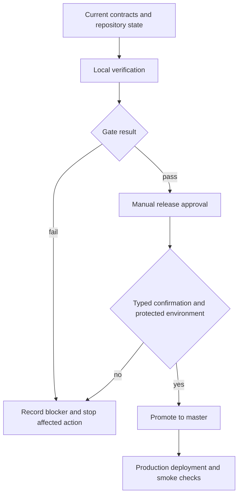
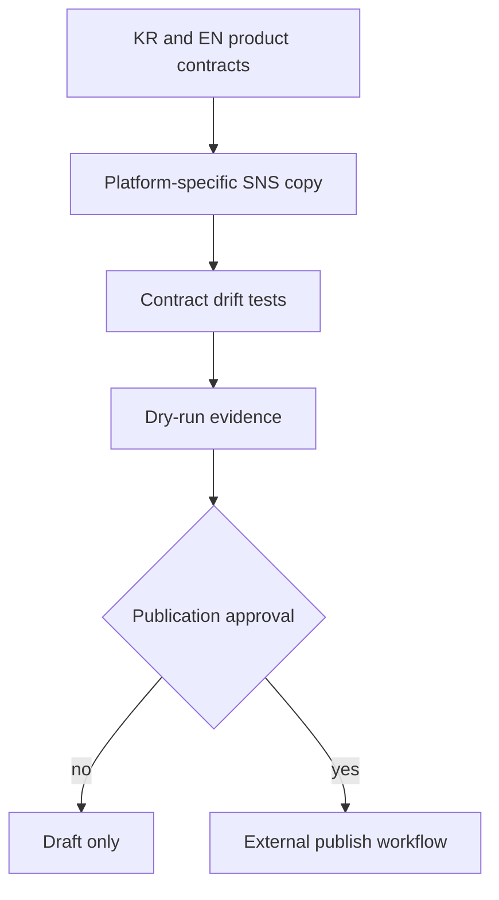

# GloSource Operational Governance - Plan

## Goal Capsule

- **Objective:** Bring GloSource AI's release, public claims, growth scripts, and harness evidence into alignment with the current operating instructions and product contracts.
- **Authority:** Current user instructions and `README.md` product contracts override stale harness notes and generated growth reports.
- **Execution profile:** Preserve the dirty working tree. Make bounded, reviewable edits. Do not publish, push, promote, deploy, send outreach, migrate production data, or run a real payment.
- **Stop conditions:** Stop before any external mutation, secret disclosure, destructive rewrite, or product-scope decision that cannot be derived from the current contracts.
- **Tail ownership:** Local implementation and verification only. The operator retains approval for commit, push, production promotion, social publication, outbound contact, and payment testing.

---

## Product Contract

### Summary

GloSource AI already has a strong technical safety baseline, but operational control and sales messaging have drifted. This plan makes deployment approval explicit, aligns active SNS scripts with the live KR/EN contracts, removes unsupported precision from public examples, and restores the harness as a current evidence record.

### Problem Frame

The application passes its tests and live contract checks, yet a branch push can promote to production automatically. Several active growth scripts still advertise retired EN quotas and prices. The KR landing publishes precise savings and sourcing-result figures without a repository evidence trail. Harness files pass structural checks while describing an older commit, older prices, and older validation results.

### Requirements

**Release control**

- R1. A branch push may verify code but must not fast-forward `master` or trigger production deployment.
- R2. Production promotion must require an explicit manual dispatch, a typed confirmation, successful verification, and the protected production environment.
- R3. Release checks must not expose secret values or treat a local archive as production authorization.

**Product and growth contracts**

- R4. Active EN growth scripts must advertise an account-based three-search monthly free tier and current paid pricing.
- R5. Retired claims such as five anonymous searches, ten account searches, and a $19 starting plan must fail automated tests if they return.
- R6. KR and EN messaging must remain directionally distinct and must not describe supplier candidates as audited, endorsed, guaranteed, or independently verified.

**Evidence and public claims**

- R7. Public sourcing examples without reproducible evidence must be labeled as illustrative and must not present precise savings, price, certification, or supplier-count claims as observed results.
- R8. Registry matches, platform signals, prices, MOQ, lead times, and AI scores must retain their existing evidence or estimate labels.

**Harness and operations**

- R9. Harness status must identify its calibration date, code baseline, dirty-source state, latest verification, and unresolved external gates without claiming completion from stale evidence.
- R10. The execution metaprompt must define the order, approval boundaries, evidence requirements, failure handling, and completion report for future runs.

### Acceptance Examples

- AE1. Covers R1 and R2. Given a normal feature-branch push, verification runs but no command can update `master`; given a manual dispatch without the confirmation phrase, promotion does not run.
- AE2. Covers R4 and R5. Given any active SNS launcher, scanning its publishable copy finds the three-search account offer and finds none of the retired free-tier or $19 claims.
- AE3. Covers R7. Given the KR use-case cards, a visitor sees illustrative scenarios and verification prompts rather than unsupported percentage savings or asserted supplier results.
- AE4. Covers R9. Given the harness summary, an operator can distinguish current local verification from stale market evidence and external approval gates.

### Scope Boundaries

In scope: release workflow governance, active SNS launcher copy, public KR example claims, executable drift tests, the operational metaprompt, and GloSource harness calibration.

Out of scope: external posting, email or DM sending, commit or push, Vercel deployment, production environment mutation, real payment/refund testing, database migration, lead enrichment, and fabricated market evidence.

---

## Planning Contract

### Key Technical Decisions

- KTD1. **Separate verify from promote.** Branch pushes retain automated verification, while only a confirmed manual dispatch may promote through the protected production environment. This satisfies R1-R3 and prevents a missing escape tag from becoming deployment authorization.
- KTD2. **Guard commercial copy with executable drift tests.** Active launchers may keep platform-specific voice, but free-tier and price facts are checked as one product contract. This satisfies R4-R6 without forcing every platform into identical prose.
- KTD3. **Remove unsupported precision instead of weakening a disclaimer.** Illustrative KR scenarios keep their educational structure but lose precise outcome claims that have no evidence trail. This satisfies R7-R8.
- KTD4. **Calibrate evidence without inventing freshness.** Harness files record the current code baseline and today's local checks while retaining the date of the last real buyer-activity capture. This satisfies R9.
- KTD5. **Use the metaprompt as the operating contract.** Future runs follow a single ordered gate from orientation to closeout and stop at approval boundaries. This satisfies R10.

### High-Level Technical Design

### Assumptions

- The user-directed request to set a Goal and proceed authorizes local planning, editing, and verification but not external publication or deployment.
- Current `README.md` and code-derived contracts are authoritative over historical growth outputs and stale harness text.
- The existing dirty changes are user-owned and remain intact.
- Production environment readiness cannot be inferred from the local process environment.

### Risks and Dependencies

- GitHub's `production` environment must be configured with required reviewers for the protected-environment gate to provide human approval.
- Historic reports will continue to contain old copy; tests target active launch scripts and product surfaces, not immutable evidence archives.
- Real buyer activity, production environment values, and payment lifecycle evidence remain external gates.

---

## Implementation Units

### U1. Establish the operating metaprompt

- **Goal:** Create the canonical ordered workflow for future GloSource governance runs.
- **Requirements:** R3, R9, R10.
- **Dependencies:** None.
- **Files:** `docs/operations/GLOSOURCE_GLOBAL_INSTRUCTION_EXECUTION_METAPROMPT.md`.
- **Approach:** Define goals, sources of truth, phases, approval gates, evidence schema, stop rules, recovery, and final reporting. Keep commands illustrative and make external mutations approval-bound.
- **Patterns to follow:** `docs/operations/NEXT_PRODUCTIZATION_METAPROMPT.md`, `docs/operations/PRODUCTIZATION.md`.
- **Test scenarios:** Test expectation: none -- this unit is an operational decision document; verification is a completeness and contradiction review.
- **Verification:** The document covers research, planning, implementation, verification, release, growth, evidence, and closeout in one ordered contract.

### U2. Require explicit production promotion

- **Goal:** Preserve automated verification while removing production promotion from ordinary branch pushes.
- **Requirements:** R1-R3; AE1.
- **Dependencies:** U1.
- **Files:** `.github/workflows/promote.yml`, `tests/release-governance.test.ts`.
- **Approach:** Split verification and promotion responsibilities. Gate promotion on manual dispatch, a typed confirmation, successful verification, fast-forward safety, and the protected production environment.
- **Execution note:** Add a failing workflow-governance test before changing the workflow.
- **Patterns to follow:** Existing fast-forward and injection-safe Git logic in `.github/workflows/promote.yml`.
- **Test scenarios:**
  - A feature-branch push triggers verification and cannot satisfy the promotion job condition.
  - A manual dispatch without the exact confirmation value cannot promote.
  - A confirmed manual dispatch depends on verification and declares the protected production environment.
  - The workflow keeps fast-forward-only protection and does not interpolate untrusted commit text into shell commands.
- **Verification:** The governance test and normal test suite pass, and workflow inspection shows no push-triggered `git push origin HEAD:master` path.

### U3. Eliminate active SNS contract drift

- **Goal:** Align publishable platform scripts with the current EN free and paid contracts.
- **Requirements:** R4-R6; AE2.
- **Dependencies:** None.
- **Files:** `scripts/growth/reddit-launch.js`, `scripts/growth/instagram-launch.js`, `scripts/growth/linkedin-launch-handler.js`, `scripts/growth/discord-launch.js`, `tests/growth-copy-contract.test.ts`.
- **Approach:** Preserve platform tone while replacing retired quota and price statements. Add a repository test that scans all active launchers for banned commercial claims and required current facts.
- **Execution note:** Capture the current test failure against retired copy before editing launchers.
- **Patterns to follow:** `tests/product-contracts.test.ts`, `scripts/growth/audit-brand-consistency.js`.
- **Test scenarios:**
  - Retired five-anonymous and ten-account free offers fail the test.
  - A retired $19 paid offer fails the test.
  - The current three-search account offer and $39 entry price pass.
  - Supplier-verification guarantee phrases fail when introduced into active launchers.
- **Verification:** Focused drift tests pass and `npm run growth:social:dry-run` produces only current-contract copy when its local prerequisites are available.

### U4. Make KR examples evidence-safe

- **Goal:** Keep useful scenario structure without presenting unsupported numeric outcomes as observed evidence.
- **Requirements:** R7-R8; AE3.
- **Dependencies:** None.
- **Files:** `app/HomePageClient.tsx`, `tests/marketing-claims.test.ts`.
- **Approach:** Relabel the section as illustrative, replace unsupported numbers with fields that tell buyers what must be requested or independently checked, and retain the research-tool disclaimer.
- **Execution note:** Add a failing claim-scan test before changing the public component.
- **Patterns to follow:** Evidence labeling tests in `tests/source-quality.test.ts` and disclaimers in the EN product surfaces.
- **Test scenarios:**
  - Unsupported savings percentages are absent from the KR landing source.
  - Scenario cards identify themselves as illustrative rather than completed customer outcomes.
  - Price, MOQ, supplier identity, certification, and after-sales claims are framed as questions or verification fields.
  - Existing AI-estimate and independent-due-diligence messaging remains present.
- **Verification:** Focused tests pass and the production build renders the KR landing without the retired precise claims.

### U5. Recalibrate the harness

- **Goal:** Make the harness describe the current technical state and the age of market evidence accurately.
- **Requirements:** R9-R10; AE4.
- **Dependencies:** U2-U4.
- **Files:** `docs/harness/STATUS.md`, `docs/harness/STATE.json`, `docs/harness/TESTS.md`, `docs/harness/PLAN.md`.
- **Approach:** Update the calibration date, baseline SHA, dirty-source note, current price contract, current verification counts, and external blockers. Preserve historical evidence and explicitly date it instead of rewriting it as current.
- **Patterns to follow:** `docs/harness/FINAL_14_DAY_REPORT.md`, `scripts/check-state-json.mjs`.
- **Test scenarios:** Test expectation: none -- this is evidence calibration; existing state, placeholder, sensitive-string, and drift checks provide verification.
- **Verification:** Harness checks pass, retired prices are absent from active instructions, and the status separates today's technical verification from the last buyer-activity capture.

---

## Verification Contract

| Gate | Applies to | Done signal |
|---|---|---|
| Focused governance and copy tests | U2-U4 | New tests demonstrate pre-change failure or characterization and pass after implementation. |
| `npm test` | U2-U4 | Entire suite passes with no skipped or failed tests. |
| `npx tsc --noEmit` | All code units | Exit code 0. Run separately from the Next build. |
| `npm run lint` | All code units | Zero errors; any retained warning is identified as pre-existing. |
| `npm run build` | U2-U4 | Optimized production build completes. |
| `npm run growth:audit` | U3-U4 | Locale and brand audits pass. |
| `npm run growth:payments` | Release evidence | Current Polar product and checkout contracts pass; this does not count as a real payment test. |
| `npm run growth:live-contract` | Public contract | All expected live routes pass without changing production. |
| Harness scripts | U5 | State JSON, sensitive strings, placeholders, and `git diff --check` pass. |
| `npm run readiness:product` | Release decision | Expected to remain blocked until environment and clean-provenance conditions are met; blockers must name variables only. |
| `npm run growth:acquisition:gate` | Publication decision | Expected to remain blocked until current daily and dry-run evidence exists; no external publishing occurs. |

## Closeout - 2026-08-04

- U1-U5 implemented in the local working tree. No commit, push, production deployment, external publication, outbound send, or payment action was performed.
- Final local gates: `npm test` 164/164, TypeScript, lint with 0 errors and 1 pre-existing warning, production build with 89 routes, growth audit, Polar contract, seven official-route checks, social dry-run, state JSON, sensitive-string, placeholder, and diff checks passed.
- `readiness:product` remains blocked by five missing local-process variable names and dirty provenance. A separate Vercel Production name-only audit found 20/22 required names, with `AUTH_TRUST_HOST` and `DATAGO_SERVICE_KEY` missing; values were not read.
- `growth:daily` and `growth:acquisition:gate` pass with current daily and social dry-run evidence. Case-study extraction returned 0 candidates and is not treated as traction.
- Release remains blocked because GitHub `Production` currently has no protection rules or deployment branch policy. Required reviewers, self-review prevention, and an allowed branch policy must be configured before the changed workflow is tested remotely.
- Known local test limits are maintained in `docs/harness/TESTS.md` rather than being represented as completed evidence.

---

## Definition of Done

- Ordinary branch pushes cannot promote or deploy production.
- Manual promotion requires explicit confirmation, successful verification, and the protected production environment.
- Active SNS launchers contain current EN free and paid contracts and are protected by drift tests.
- The KR landing contains no unsupported precise savings or sourcing-result assertions.
- Harness files describe today's local technical verification and separately date stale market evidence.
- The operational metaprompt is complete and consistent with the current global instructions.
- All applicable local verification gates pass; expected external blockers are reported without invented completion.
- Existing user changes remain preserved, and abandoned implementation attempts are absent from the final diff.
- No commit, push, deployment, publication, outbound send, production data change, or real payment is performed without separate authorization.
