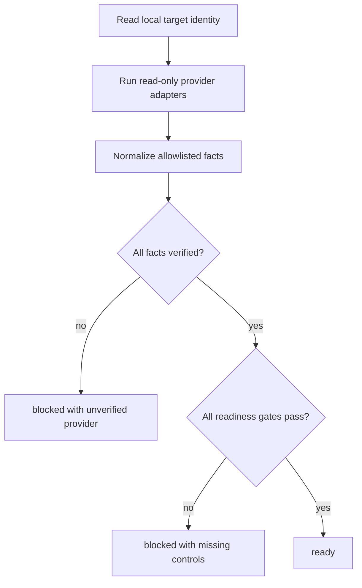

# Production Control Plane Readiness - Plan

## Goal Capsule

- **Objective:** Give the GloSource AI operator one read-only, machine-readable decision on Vercel Production configuration and GitHub Production approval controls before any external mutation or deployment.
- **Authority:** Current repository and direct read-only provider evidence override harness summaries and historical notes.
- **Execution profile:** Implement locally, verify against fixtures and the current provider state, and stop before external configuration changes.
- **Stop conditions:** Any provider, authentication, target-identity, or parsing uncertainty must produce `blocked`; no secret value, raw provider output, external write, push, workflow dispatch, or deployment is authorized.
- **Tail ownership:** The operator owns every Vercel or GitHub setting change after reviewing the audit result.

---

## Product Contract

### Summary

Add a fail-closed Production control-plane audit that compares required Vercel Production variable names and inspects GitHub Production approval controls without exposing values or changing provider state.

### Problem Frame

The existing product-readiness command evaluates the local process environment and cannot prove Vercel Production readiness.
Direct inspection also confirmed that a workflow job naming `environment: production` does not create a human approval gate when that environment has no protection rules.
Operators need one repeatable decision that preserves these distinctions and cannot accidentally convert missing evidence into deployment authority.

### Requirements

#### Provider identity and environment coverage

- R1. The audit must use `scripts/package-release.ts` as the only source of required Production environment variable names.
- R2. The audit must verify that the linked Vercel project identity is complete before evaluating Vercel Production.
- R3. The audit must report exact missing variable names, counts, and `valuesIncluded: false` without serializing provider values or raw output.

#### Approval controls

- R4. The audit must derive the GitHub repository from `origin` and inspect the `Production` environment through a read-only request.
- R5. A required-reviewer rule with at least one reviewer and `prevent_self_review: true` is required for approval readiness.
- R6. A missing deployment branch policy must remain a blocker that requires operator design because a master-only policy can deadlock the current feature-ref promotion workflow.

#### Failure and authority boundaries

- R7. Missing tools, authentication failures, target ambiguity, nonzero provider commands, empty output, or unknown response shapes must fail closed.
- R8. The command must not create, update, or delete provider settings, read environment values into a file, push, dispatch a workflow, promote, or deploy.
- R9. The report must expose only normalized counts, names, booleans, query status, and blockers; reviewer identities and raw provider errors are excluded.

### Acceptance Examples

- AE1. Given the current Vercel name set, when the audit runs, then it reports 20 of 22 configured and names only `AUTH_TRUST_HOST` and `DATAGO_SERVICE_KEY` as missing.
- AE2. Given `protection_rules: []` and `deployment_branch_policy: null`, when the audit runs, then GitHub is reported as existing but not approval-ready and the overall result is `blocked`.
- AE3. Given a provider command or parser failure containing a fake secret, when the report is serialized, then the result is `blocked` and the fake secret and raw error are absent.
- AE4. Given complete variable names, a required reviewer, self-review prevention, and a non-null branch policy, when the report is built, then the result is `ready`.

### Scope Boundaries

- **In scope:** Read-only provider queries, sanitized normalization, deterministic readiness evaluation, automated tests, operator metaprompt, and harness evidence updates.
- **Outside scope:** Provider configuration changes, secret handling, reviewer selection, branch-policy design, commit, push, workflow dispatch, deployment, and production verification after a future setting change.

---

## Planning Contract

### Assumptions

- The pinned Vercel CLI listing remains the available read-only adapter; its output is treated as untrusted data and is never forwarded to the report.
- `prevent_self_review: true` is required to make the approval gate independent, even though a solo reviewer configuration could block promotion.
- A non-null branch policy is required for the final `ready` state, but this work does not choose or set the policy.

### Key Technical Decisions

- KTD1. **Separate collection from evaluation.** Provider adapters collect transient output, pure functions normalize it, and one evaluator builds the public report so fixture tests do not access the network.
- KTD2. **Use a pinned Vercel CLI adapter.** The durable command avoids the broken global shim and avoids `latest` output drift; provider command details remain internal to the adapter.
- KTD3. **Never serialize raw provider data.** The report is constructed from allowlisted fields only, and command failures become generic provider-specific blockers without stdout or stderr.
- KTD4. **Treat branch policy as observed but unresolved.** A null policy blocks readiness, while the tool avoids prescribing `master` because the workflow requests Production approval before it pushes the selected feature ref to `master`.
- KTD5. **Distinguish blocked from unverified.** Overall status remains `ready | blocked`; each provider query carries `verified | unverified` so an access failure cannot be mistaken for a confirmed missing configuration.

### High-Level Technical Design

### Sources and Research

- `scripts/check-product-readiness.ts` and `tests/product-readiness.test.ts` define the local report, entry-point, and redaction patterns.
- `.github/workflows/promote.yml` proves that the selected feature ref reaches the Production environment before the fast-forward push to `master`.
- GitHub's deployment-environment API documents `required_reviewers`, `prevent_self_review`, and `deployment_branch_policy` as distinct controls: <https://docs.github.com/en/rest/deployments/environments>.
- GitHub's environment guidance confirms that required reviewers create manual approval and that self-review prevention requires a different reviewer: <https://docs.github.com/en/actions/reference/workflows-and-actions/deployments-and-environments>.
- Vercel documents `vercel env ls production` as the environment-specific audit command: <https://vercel.com/docs/cli/env>.
- No `docs/solutions/` corpus exists, so current repository patterns and direct provider evidence are the institutional baseline for this unit.

---

## Implementation Units

### U1. Define the sanitized readiness contract

- **Goal:** Implement pure Vercel parsing, GitHub normalization, and fail-closed report evaluation.
- **Requirements:** R1-R7, R9; AE1-AE4.
- **Dependencies:** None.
- **Files:** `scripts/check-production-control-plane-readiness.ts`, `tests/control-plane-readiness.test.ts`.
- **Approach:** Parse only exact required names from recognized Production table rows, normalize only allowlisted GitHub protection fields, and build the report without retaining raw provider data.
- **Execution note:** Start with fixture tests that prove current blockers and secret non-disclosure before adding live adapters.
- **Patterns to follow:** `scripts/check-product-readiness.ts`, `tests/product-readiness.test.ts`.
- **Test scenarios:**
  - Covers AE1. A recognized Production listing with 20 required names returns exactly the two known missing names.
  - ANSI and table noise do not change exact name matching.
  - Empty or unrecognized Vercel output produces an unverified blocked result.
  - Covers AE2. Empty GitHub protection rules and a null branch policy produce explicit blockers.
  - Covers AE3. Fake values and raw error text never appear in serialized output.
  - Covers AE4. Complete normalized inputs produce `ready`.
- **Verification:** Focused tests prove deterministic parsing, policy normalization, fail-closed behavior, and the public output allowlist.

### U2. Add read-only live adapters and command entry point

- **Goal:** Query the linked Vercel project and GitHub Production environment and emit the sanitized report with a useful exit status.
- **Requirements:** R2-R4, R7-R9.
- **Dependencies:** U1.
- **Files:** `scripts/check-production-control-plane-readiness.ts`, `package.json`, `tests/control-plane-readiness.test.ts`.
- **Approach:** Reuse the established CLI entry guard, invoke only read-only commands, derive GitHub identity from origin, discard raw output after normalization, and set a nonzero exit code for blocked results.
- **Execution note:** Use fixture tests for adapters and one live read-only smoke; a live `blocked` exit is the expected current result.
- **Patterns to follow:** `scripts/check-product-readiness.ts`, `package.json` readiness scripts.
- **Test scenarios:**
  - HTTPS and SSH GitHub origin formats resolve to the same owner and repository.
  - Malformed origins, missing links, command failures, and invalid GitHub JSON fail closed.
  - The CLI entry point emits JSON only and returns exit code 1 for the current blocked state.
- **Verification:** `npm run readiness:control-plane` reports the two Vercel names and missing GitHub controls without raw output or provider mutation.

### U3. Bind the audit to operations evidence

- **Goal:** Make the audit discoverable and align harness status with the live, machine-readable result.
- **Requirements:** R6, R8-R9.
- **Dependencies:** U2.
- **Files:** `docs/operations/GLOSOURCE_PRODUCTION_CONTROL_PLANE_METAPROMPT.md`, `docs/harness/STATUS.md`, `docs/harness/STATE.json`, `docs/harness/TESTS.md`.
- **Approach:** Record the audit contract, expected blocked baseline, unresolved reviewer and branch-policy decisions, and external approval boundary without copying provider raw output.
- **Patterns to follow:** `docs/operations/NEXT_PRODUCTIZATION_METAPROMPT.md`, `docs/harness/STATUS.md`, `docs/harness/STATE.json`, `docs/harness/TESTS.md`.
- **Test scenarios:**
  - Test expectation: none -- this unit changes operational documentation and machine-readable harness state, which existing structural gates validate.
- **Verification:** Harness JSON, placeholder, sensitive-string, and diff checks pass; documents distinguish confirmed facts from unperformed external changes.

---

## Risks & Dependencies

- Vercel CLI table output can drift; the parser must reject unknown shapes instead of guessing.
- The read-only commands still depend on valid local authentication and exact project/repository linkage.
- GitHub plan or repository visibility can limit required-reviewer features; an unavailable protection rule remains blocked, not waived.
- A master-only deployment branch policy can prevent the current feature-ref workflow from reaching its promote step.
- The working tree already contains unrelated user changes, so implementation and verification must remain narrowly scoped and no commit is authorized.

---

## Verification Contract

| Gate | Applies to | Done signal |
|---|---|---|
| `npx tsx --test tests/control-plane-readiness.test.ts` | U1-U2 | All parser, evaluator, identity, and redaction scenarios pass |
| `npm run readiness:control-plane` | U2-U3 | Expected current `blocked` JSON names two missing Vercel variables and absent GitHub controls only |
| `npm test` | U1-U3 | Full suite passes |
| `npx tsc --noEmit` | U1-U3 | Type check exits 0 |
| `npm run lint` | U1-U3 | No new errors or warnings |
| `node scripts/check-state-json.mjs` | U3 | Harness state is valid |
| `node scripts/check-harness-placeholders.mjs` | U3 | Harness docs contain no placeholders |
| `node scripts/check-sensitive-strings.mjs .harness-blocklist.local` | U1-U3 | Sensitive-string scan is clean |
| `git diff --check` | U1-U3 | Diff formatting is clean |

---

## Definition of Done

- U1-U3 satisfy their test scenarios and verification outcomes.
- The audit uses the canonical required-name list and emits no value, raw provider output, raw error, token, or reviewer identity.
- Provider uncertainty always blocks and remains distinguishable from confirmed missing configuration.
- The live audit reproduces the current two missing Vercel names and missing GitHub controls.
- No provider setting, repository ref, workflow run, deployment, or production data is changed.
- The diff contains no abandoned experimental adapter or duplicated environment contract.
