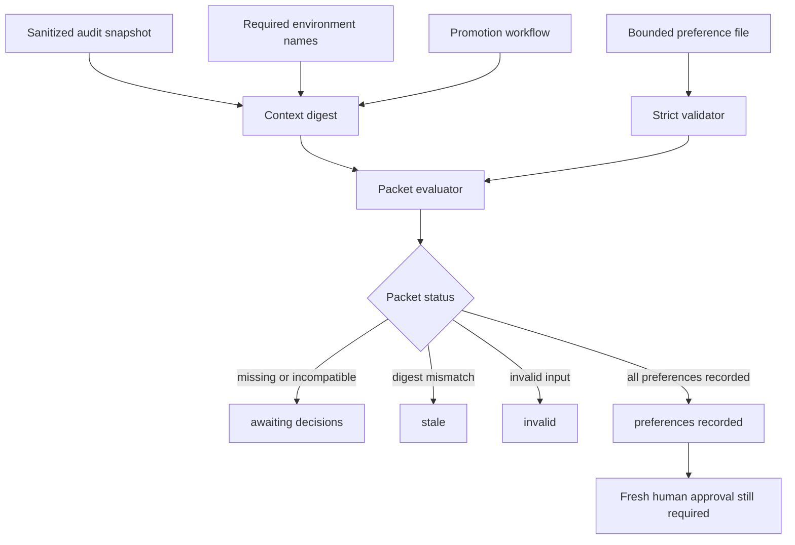

# Production Remediation Approval Packet - Plan

## Goal Capsule

- **Objective:** Record the operator's non-sensitive Production remediation preferences against current audited context without granting or applying external authority.
- **Authority:** Repository approval rules and the sanitized control-plane audit override preference input.
- **Execution profile:** Local deterministic validation and JSON output only.
- **Stop conditions:** Any secret, reviewer identity, unknown input, stale context, incompatible branch policy, or provider mutation requirement stops the packet.
- **Tail ownership:** A human operator owns reviewer identity, secret entry, branch patterns, provider writes, workflow dispatch, and post-change verification.

---

## Product Contract

### Summary

Add a local approval packet that separates recorded preferences from Production readiness and execution authority.
The packet consumes only sanitized audit facts and bounded preference codes.

### Problem Frame

The current control-plane audit identifies missing Vercel names and GitHub protection controls, but the next operator decisions are not captured in a deterministic or stale-safe form.
A generic approval flag would collapse independent decisions and could be mistaken for permission to mutate external systems.

### Requirements

**Input safety**

- R1. The preference schema accepts exactly four bounded decision fields plus a schema version and context digest.
- R2. Unknown fields or values invalidate the full input without echoing rejected content.
- R3. The schema never accepts a secret value, reviewer identity, exact branch pattern, provider payload, or execution command.

**Decision semantics**

- R4. The packet records `AUTH_TRUST_HOST`, DATAGO secret custody, independent-reviewer policy, and branch-policy strategy independently.
- R5. `protected_master_only` is incompatible with the current feature-ref promotion flow and cannot produce `preferences_recorded`.
- R6. Preference completion never changes the audited `ready | blocked` state or authorizes a provider mutation.

**Context and output safety**

- R7. The packet binds preferences to a deterministic digest of sanitized audit facts, the canonical required-name contract, and the promotion workflow.
- R8. A supplied non-null digest that differs from the current digest produces `stale`.
- R9. Output exposes only normalized codes, generic blockers, a digest, and fixed false safety invariants.
- R10. Packet generation performs no provider write, workflow dispatch, push, promotion, deployment, or file persistence.

### Acceptance Examples

- AE1. Given deferred preferences and no acknowledged digest, the packet returns `awaiting_decisions` and no mutation authority.
- AE2. Given all bounded preferences and a matching digest, the packet returns `preferences_recorded` while audited readiness remains `blocked`.
- AE3. Given a secret, reviewer identity, unknown field, or unknown enum, the packet returns `invalid` without serializing the rejected content.
- AE4. Given a changed audit, required-name contract, or workflow, a previously acknowledged digest returns `stale`.
- AE5. Given `protected_master_only`, the packet remains `awaiting_decisions` with a workflow-compatibility blocker.

### Scope Boundaries

In scope: local schema validation, context digesting, sanitized JSON, tests, an unresolved example input, and harness documentation.

Outside scope: actual reviewer selection, secret handling, branch pattern selection, provider writes, workflow changes, commit, push, promotion, deployment, payment testing, and publication.

---

## Planning Contract

- KTD1. **Preference state is not approval state.** Use `awaiting_decisions | preferences_recorded | stale | invalid | not_required`; never label the packet approved or complete. Governs R4, R6, R9.
- KTD2. **Strict recursive allowlist.** Reject the full input on any unknown key or enum and return a generic invalid result. Governs R1-R3.
- KTD3. **Context-bound decisions.** Hash normalized audit output, `REQUIRED_PRODUCTION_ENV`, and `.github/workflows/promote.yml`; never hash secret values or reviewer identities. Governs R7-R8.
- KTD4. **Provider isolation.** The packet builder accepts a sanitized audit object and local file content; its CLI performs no network, subprocess, or provider operation. Governs R9-R10.
- KTD5. **Branch strategy remains a preference.** Custom feature-ref or dedicated release-branch strategy may be recorded, but exact patterns and compatibility proof remain human-only. Governs R5-R6.

### Assumptions

- The existing control-plane audit remains the source for Production readiness.
- A DATAGO custody preference is an operator statement, not proof that the secret is valid.
- A selected reviewer policy does not identify or verify an actual reviewer.
- The user asked to proceed, so the plan uses the safe local-only scope without another scoping checkpoint.

### High-Level Technical Design

---

## Implementation Units

### U1. Approval metaprompt and bounded input contract

- **Goal:** Define the non-authorizing preference semantics and human-only boundary.
- **Requirements:** R1-R6, R9-R10; AE1-AE3, AE5.
- **Dependencies:** None.
- **Files:** `docs/operations/GLOSOURCE_PRODUCTION_REMEDIATION_APPROVAL_METAPROMPT.md`, `docs/operations/production-remediation-preferences.example.json`.
- **Approach:** Keep the tracked example fully deferred and free of identities, values, patterns, and approval claims.
- **Test scenarios:** Static validation rejects extra fields and confirms the example is `awaiting_decisions`.
- **Verification:** A reader cannot treat the artifact as external mutation authority.

### U2. Deterministic packet evaluator

- **Goal:** Validate preferences, calculate context freshness, and return sanitized packet status.
- **Requirements:** R1-R10; AE1-AE5.
- **Dependencies:** U1.
- **Files:** `scripts/build-production-remediation-approval-packet.ts`, `tests/production-remediation-approval.test.ts`.
- **Approach:** Follow the pure-builder and thin-CLI pattern in `scripts/check-product-readiness.ts`; import the canonical required-name list and accept sanitized audit data rather than invoking a provider.
- **Execution note:** Start with failing tests for invalid-input redaction, stale context, and fixed mutation invariants.
- **Test scenarios:**
  1. Covers AE1. Deferred input produces deterministic decision blockers.
  2. Covers AE2. Matching context and selected preferences record preferences but retain blocked readiness.
  3. Covers AE3. Secret and reviewer identity fields invalidate without appearing in output.
  4. Covers AE4. Audit or workflow drift changes the digest and produces `stale`.
  5. Covers AE5. `protected_master_only` is reported as incompatible.
  6. Unknown schema versions, enums, nested keys, and malformed audit input fail closed.
  7. The source contains no subprocess, network, provider-write, or workflow-dispatch adapter.
- **Verification:** Focused tests prove determinism, redaction, stale detection, and no-authority invariants.

### U3. Operator entry point and harness evidence

- **Goal:** Make the packet reproducible without changing provider state and record the resulting boundary.
- **Requirements:** R6-R10.
- **Dependencies:** U2.
- **Files:** `package.json`, `docs/harness/STATUS.md`, `docs/harness/TESTS.md`, `docs/harness/STATE.json`.
- **Approach:** Add a `readiness:remediation-approval` command that reads local JSON inputs and writes sanitized JSON to stdout only; document that selected operator packets belong under an existing ignored private-report path.
- **Test scenarios:** The tracked deferred example exits non-ready, produces no identity or value, and performs no external mutation.
- **Verification:** Focused and full tests, type checking, lint, harness checks, sensitive-string scan, and diff integrity pass.

---

## Verification Contract

| Gate | Applies to | Done signal |
|---|---|---|
| Focused packet tests | U1-U3 | All decision, stale, redaction, and isolation scenarios pass |
| `npm test` | U2-U3 | Full repository regression suite passes |
| `npx tsc --noEmit` | U2-U3 | Type checking exits cleanly |
| `npm run lint` | U2-U3 | No new lint errors or warnings |
| Harness and sensitive checks | U3 | State, placeholder, secret, and diff checks are clean |
| Example packet run | U3 | Returns `awaiting_decisions`, blocked readiness, and all safety invariants |

---

## Definition of Done

- The metaprompt, deferred example, evaluator, tests, package command, and harness evidence exist.
- Invalid or sensitive-shaped input is rejected without reflection.
- Context drift produces `stale`.
- All selected preferences still produce `providerMutationAuthorized: false` and `not_attempted_by_design`.
- No external setting, workflow, Git state, deployment, payment, publication, or secret is changed.
- Focused, regression, type, lint, harness, sensitive, and diff checks pass or any pre-existing limitation is recorded.
- Dead-end implementation code and temporary tracked artifacts are absent.
